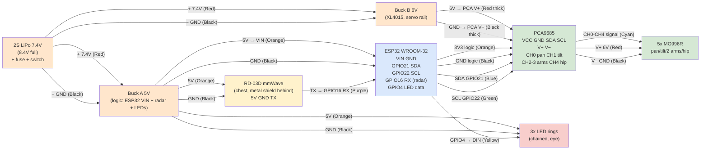

# Pit Droid Wiring — 2S LiPo + RD-03D + 5 Servos + 3 LED Rings

## Notes

- **Common GND**: LiPo −, Buck A −, Buck B −, ESP32, PCA, radar, LEDs all tied together.
- **Metal shield behind RD-03D**, plastic chest plate only in front, rigid mount.
- **Do NOT power servos from Buck A** — servo rail is Buck B only.
- **Neck cable**: 20 AWG servo power, 22–24 AWG signal/radar/LED, silicone insulation.
